# FavStash Creator Skills: find ideas, script, edit and publish short videos with Claude Code or Codex

[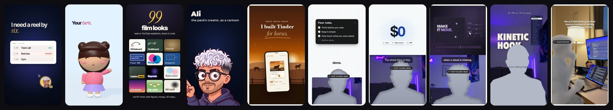](#pick-a-style)

**Turn your coding agent into a video studio.** Hand it a script and it makes the whole
video, in code, on your laptop: a Reel, a TikTok, a Short, or a 16:9 explainer for
YouTube. **99 film looks** (whiteboard, stick figures, cel anime, manga, newsreel, 3D
maps, tilt-shift, risograph…), a cute 3D character, a lip-synced cartoon of you, and
five styles for when you are on camera. No camera needed, no video model, no stock
footage, no subscription. Free and open source, for Claude Code, Codex or any
skills-aware agent.

- 🎬 **99 film looks**, each a full style guide: layout, type, motion, camera, sound and what goes on the first frame.
- 📺 **Reels and YouTube.** Every look comes as a 9:16 reel and a 16:9 explainer in chapters.
- 🧸 **Characters.** A chibi 3D kid, or a cartoon of you made from a few photos with any image AI.
- 🎙️ **Free voices.** Your own recording, a free local voice, or ElevenLabs, with every word timed.
- 🔁 **The whole loop.** Find proven ideas, write the script, edit, then publish and learn with [FavStash](https://www.favstash.app/).

**Give this prompt to your agent:**

```text
Set up FavStash creator skills for my short-form workflow.
Clone https://github.com/alisadiq-ai/favstash-ai-video-editing-skills and follow:
https://raw.githubusercontent.com/alisadiq-ai/favstash-ai-video-editing-skills/main/INSTALL_FOR_AGENTS.md

Install all fourteen skills and the local media tools they need in my workspace.
Check whether FavStash is connected; if not, connect it with the FavStash CLI
(Codex or Claude Code) or guide me through sign-in. Verify the setup, then tell
me how to start my first reel.
```

## Pick a style

[`edit-video`](skills/3-editing/edit-video/SKILL.md) is the base for every edit: the cut,
captions, voice, sound and review. Add one style on top. The styles sit on three
shelves, and each shelf is a folder.

### No camera: fully animated

[`skills/3-styles-animated/`](skills/3-styles-animated)

<table><tr>
<td width="33%" valign="top"><a href="skills/3-styles-animated/film-styles/SKILL.md">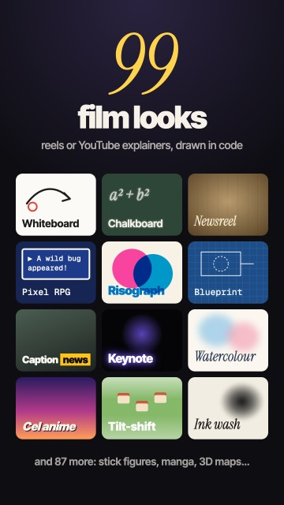</a><br><b><a href="skills/3-styles-animated/film-styles/SKILL.md">film-styles</a></b><br><sub>99 film looks, each a full style guide with a reel format and a YouTube format. Name one and bring a story.</sub></td>
<td width="33%" valign="top"><a href="skills/3-styles-animated/animated-explainer/SKILL.md">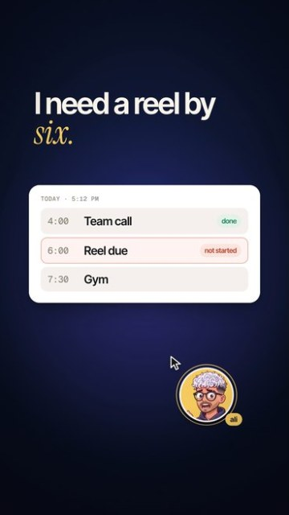</a><br><b><a href="skills/3-styles-animated/animated-explainer/SKILL.md">animated-explainer</a></b><br><sub>A whole reel keyed to the voice: one hero card per beat, the line lit word by word, every click and sound on its word. Two voices can talk.</sub></td>
<td width="33%" valign="top"><a href="skills/3-styles-animated/product-motion-ads/SKILL.md">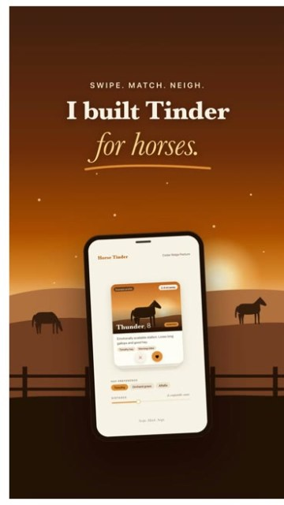</a><br><b><a href="skills/3-styles-animated/product-motion-ads/SKILL.md">product-motion-ads</a></b><br><sub>A motion-graphics ad built from your product itself (an app, a site, a gadget), ending on a comment-to-DM giveaway. Also cuts a 16:9 launch film.</sub></td>
</tr></table>

#### The 99 film looks

Grouped by what the picture looks like. Each name opens its style guide; the
[style index](skills/3-styles-animated/film-styles/styles/README.md) says what each looks like and what it's good for.

<!-- film-looks:start -->
| Group | Looks |
| --- | --- |
| Edit & documentary | [1920s Newsreel](skills/3-styles-animated/film-styles/styles/01-edit-documentary/newsreel/STYLE.md), [Broadcast News Package](skills/3-styles-animated/film-styles/styles/01-edit-documentary/news-package/STYLE.md), [Caption News](skills/3-styles-animated/film-styles/styles/01-edit-documentary/caption-news/STYLE.md), [Constructivist Montage](skills/3-styles-animated/film-styles/styles/01-edit-documentary/kino-montage/STYLE.md), [Live Countdown Split-screen](skills/3-styles-animated/film-styles/styles/01-edit-documentary/countdown/STYLE.md), [Sports Telestrator](skills/3-styles-animated/film-styles/styles/01-edit-documentary/telestrator/STYLE.md), [Time-lapse Symphony](skills/3-styles-animated/film-styles/styles/01-edit-documentary/city-symphony/STYLE.md), [Visual Investigation](skills/3-styles-animated/film-styles/styles/01-edit-documentary/visual-investigation/STYLE.md) |
| Painting & illustration | [Colored-Pencil Science Illustration](skills/3-styles-animated/film-styles/styles/02-painting/colored-pencil/STYLE.md), [Crayon Picture Book](skills/3-styles-animated/film-styles/styles/02-painting/crayon-book/STYLE.md), [Impasto Oil Painting](skills/3-styles-animated/film-styles/styles/02-painting/impasto/STYLE.md), [Urban Sketch · Pen & Wash](skills/3-styles-animated/film-styles/styles/02-painting/urban-sketch/STYLE.md), [Watercolor Brush](skills/3-styles-animated/film-styles/styles/02-painting/watercolor/STYLE.md) |
| Sketch & board | [Chalkboard](skills/3-styles-animated/film-styles/styles/03-sketch-board/chalkboard/STYLE.md), [Marker on Paper](skills/3-styles-animated/film-styles/styles/03-sketch-board/marker-paper/STYLE.md), [One-line Drawing](skills/3-styles-animated/film-styles/styles/03-sketch-board/one-line/STYLE.md), [Sketchnote](skills/3-styles-animated/film-styles/styles/03-sketch-board/sketchnote/STYLE.md), [Stick-figure Explainer](skills/3-styles-animated/film-styles/styles/03-sketch-board/stick-explainer/STYLE.md), [Tablet Sketch Explainer](skills/3-styles-animated/film-styles/styles/03-sketch-board/ipad-sketch/STYLE.md), [Whiteboard Explainer](skills/3-styles-animated/film-styles/styles/03-sketch-board/whiteboard/STYLE.md) |
| Traditional crafts | [Chinese Ink Wash](skills/3-styles-animated/film-styles/styles/04-traditional-crafts/ink-wash/STYLE.md), [Gilded Illumination](skills/3-styles-animated/film-styles/styles/04-traditional-crafts/gilded-illumination/STYLE.md), [Paper-cut Lightbox](skills/3-styles-animated/film-styles/styles/04-traditional-crafts/paper-lantern/STYLE.md), [Red Paper-cut](skills/3-styles-animated/film-styles/styles/04-traditional-crafts/papercut-red/STYLE.md), [Shadow Puppetry](skills/3-styles-animated/film-styles/styles/04-traditional-crafts/shadow-puppet/STYLE.md), [Stained Glass](skills/3-styles-animated/film-styles/styles/04-traditional-crafts/stained-glass/STYLE.md), [Ukiyo-e](skills/3-styles-animated/film-styles/styles/04-traditional-crafts/ukiyoe/STYLE.md) |
| Print | [Copperplate Engraving](skills/3-styles-animated/film-styles/styles/05-print/engraving/STYLE.md), [Halftone Dossier](skills/3-styles-animated/film-styles/styles/05-print/halftone-dossier/STYLE.md), [Pop Art](skills/3-styles-animated/film-styles/styles/05-print/pop-art/STYLE.md), [Printed Long Take](skills/3-styles-animated/film-styles/styles/05-print/printed-long-take/STYLE.md), [Risograph Print](skills/3-styles-animated/film-styles/styles/05-print/risograph/STYLE.md), [Silkscreen Travel Poster](skills/3-styles-animated/film-styles/styles/05-print/silkscreen-poster/STYLE.md), [Vintage Engraving Collage](skills/3-styles-animated/film-styles/styles/05-print/vintage-collage/STYLE.md), [Woodcut Print](skills/3-styles-animated/film-styles/styles/05-print/woodcut/STYLE.md) |
| Graphic & type | [60s Spy Title Sequence](skills/3-styles-animated/film-styles/styles/06-graphic-type/spy-titles/STYLE.md), [Art Deco](skills/3-styles-animated/film-styles/styles/06-graphic-type/art-deco/STYLE.md), [Bauhaus Shapes](skills/3-styles-animated/film-styles/styles/06-graphic-type/bauhaus-shapes/STYLE.md), [Pictogram Motion](skills/3-styles-animated/film-styles/styles/06-graphic-type/pictogram-motion/STYLE.md), [Scale Zoom Explainer](skills/3-styles-animated/film-styles/styles/06-graphic-type/flat-space-explainer/STYLE.md), [Silhouette Rhythm](skills/3-styles-animated/film-styles/styles/06-graphic-type/silhouette-rhythm/STYLE.md), [Swiss Motion Graphics](skills/3-styles-animated/film-styles/styles/06-graphic-type/swiss-motion/STYLE.md), [Text Flash Cuts](skills/3-styles-animated/film-styles/styles/06-graphic-type/text-flash-cuts/STYLE.md) |
| Line diagrams | [Assembly-Line Diagram](skills/3-styles-animated/film-styles/styles/07-line-diagrams/assembly-line-diagram/STYLE.md), [Blueprint](skills/3-styles-animated/film-styles/styles/07-line-diagrams/blueprint/STYLE.md), [Color-Coded Mechanism](skills/3-styles-animated/film-styles/styles/07-line-diagrams/precise-mechanism/STYLE.md), [Exploded Teardown](skills/3-styles-animated/film-styles/styles/07-line-diagrams/teardown/STYLE.md), [Instruction Manual Art](skills/3-styles-animated/film-styles/styles/07-line-diagrams/instruction-manual/STYLE.md), [Isometric Infographic](skills/3-styles-animated/film-styles/styles/07-line-diagrams/iso-infographic/STYLE.md), [Line-Art Cutaway](skills/3-styles-animated/film-styles/styles/07-line-diagrams/hardcore-info/STYLE.md), [Pen Plotter](skills/3-styles-animated/film-styles/styles/07-line-diagrams/pen-plotter/STYLE.md) |
| Cartoons | [1930s Rubber Hose Cartoon](skills/3-styles-animated/film-styles/styles/08-cartoons/rubber-hose/STYLE.md), [80s Cel Anime](skills/3-styles-animated/film-styles/styles/08-cartoons/cel-anime-80s/STYLE.md), [Comic History Cartoon](skills/3-styles-animated/film-styles/styles/08-cartoons/comic-history/STYLE.md), [Manga Panels](skills/3-styles-animated/film-styles/styles/08-cartoons/manga-panels/STYLE.md), [Mid-century Cartoon](skills/3-styles-animated/film-styles/styles/08-cartoons/midcentury-toon/STYLE.md), [Sci-Fi Sitcom Toon](skills/3-styles-animated/film-styles/styles/08-cartoons/scifi-toon/STYLE.md) |
| Games | [16-bit Pixel RPG](skills/3-styles-animated/film-styles/styles/09-games/pixel-rpg/STYLE.md), [Game Show Flat](skills/3-styles-animated/film-styles/styles/09-games/game-show/STYLE.md), [HD-2D](skills/3-styles-animated/film-styles/styles/09-games/hd-2d/STYLE.md), [Microgame Frenzy](skills/3-styles-animated/film-styles/styles/09-games/microgame/STYLE.md) |
| Film & tape | [1920s Silent Film](skills/3-styles-animated/film-styles/styles/10-film-tape/silent-film/STYLE.md), [ASCII / CRT Terminal](skills/3-styles-animated/film-styles/styles/10-film-tape/ascii-crt/STYLE.md), [Double Exposure](skills/3-styles-animated/film-styles/styles/10-film-tape/double-exposure/STYLE.md), [Liminal Found Footage](skills/3-styles-animated/film-styles/styles/10-film-tape/backrooms/STYLE.md), [Scratch Film](skills/3-styles-animated/film-styles/styles/10-film-tape/scratch-film/STYLE.md) |
| Screens & interfaces | [1-bit Dither](skills/3-styles-animated/film-styles/styles/11-screens/one-bit-dither/STYLE.md), [Dark Tech Keynote](skills/3-styles-animated/film-styles/styles/11-screens/dark-keynote/STYLE.md), [Desktop Flythrough](skills/3-styles-animated/film-styles/styles/11-screens/desktop-flythrough/STYLE.md), [Living Screencast](skills/3-styles-animated/film-styles/styles/11-screens/living-screencast/STYLE.md), [Sci-fi Hologram HUD](skills/3-styles-animated/film-styles/styles/11-screens/hologram-hud/STYLE.md), [Spreadsheet Film](skills/3-styles-animated/film-styles/styles/11-screens/spreadsheet/STYLE.md) |
| Light & lines | [Circuit Board](skills/3-styles-animated/film-styles/styles/12-light-lines/circuit-board/STYLE.md), [Firefly Pointillism](skills/3-styles-animated/film-styles/styles/12-light-lines/firefly-pointillism/STYLE.md), [Flow-field Wind Lines](skills/3-styles-animated/film-styles/styles/12-light-lines/flow-field/STYLE.md), [Neon Tubes](skills/3-styles-animated/film-styles/styles/12-light-lines/neon-tubes/STYLE.md), [Oscilloscope Math](skills/3-styles-animated/film-styles/styles/12-light-lines/oscilloscope-math/STYLE.md) |
| 3D & miniature | [Brick Toy](skills/3-styles-animated/film-styles/styles/13-3d-miniature/brick-toy/STYLE.md), [Crayon World 3D](skills/3-styles-animated/film-styles/styles/13-3d-miniature/crayon-world/STYLE.md), [Glass Product Render](skills/3-styles-animated/film-styles/styles/13-3d-miniature/glass-product/STYLE.md), [Isometric Picture Book](skills/3-styles-animated/film-styles/styles/13-3d-miniature/isometric-picture-book/STYLE.md), [Low-poly Isometric Island](skills/3-styles-animated/film-styles/styles/13-3d-miniature/lowpoly-island/STYLE.md), [Memphis Diorama](skills/3-styles-animated/film-styles/styles/13-3d-miniature/memphis-diorama/STYLE.md), [Paper Pop-up Book](skills/3-styles-animated/film-styles/styles/13-3d-miniature/paper-popup/STYLE.md), [Tilt-Shift Miniature](skills/3-styles-animated/film-styles/styles/13-3d-miniature/tilt-shift/STYLE.md) |
| Instruments & evidence | [Archive Light Table](skills/3-styles-animated/film-styles/styles/14-instruments/archive-lighttable/STYLE.md), [Engineering Briefing Board](skills/3-styles-animated/film-styles/styles/14-instruments/briefing-board/STYLE.md), [LiDAR Survey](skills/3-styles-animated/film-styles/styles/14-instruments/lidar-survey/STYLE.md), [Microscope Story](skills/3-styles-animated/film-styles/styles/14-instruments/microscope/STYLE.md), [Radar Sweep Documentary](skills/3-styles-animated/film-styles/styles/14-instruments/dark-documentary/STYLE.md), [Satellite Briefing](skills/3-styles-animated/film-styles/styles/14-instruments/satellite-briefing/STYLE.md), [Security X-ray](skills/3-styles-animated/film-styles/styles/14-instruments/security-xray/STYLE.md), [Thermal Camera](skills/3-styles-animated/film-styles/styles/14-instruments/thermal-camera/STYLE.md) |
| Data & maps | [3D Map Explainer](skills/3-styles-animated/film-styles/styles/15-data-maps/map-explainer/STYLE.md), [Blob Simulation](skills/3-styles-animated/film-styles/styles/15-data-maps/pip-simulation/STYLE.md), [Data Physicalization](skills/3-styles-animated/film-styles/styles/15-data-maps/data-physical/STYLE.md), [Data Storytelling](skills/3-styles-animated/film-styles/styles/15-data-maps/dataviz/STYLE.md), [Projection on White Model](skills/3-styles-animated/film-styles/styles/15-data-maps/white-model/STYLE.md), [Transit Map](skills/3-styles-animated/film-styles/styles/15-data-maps/transit-map/STYLE.md) |
<!-- film-looks:end -->

#### Explainers for YouTube

[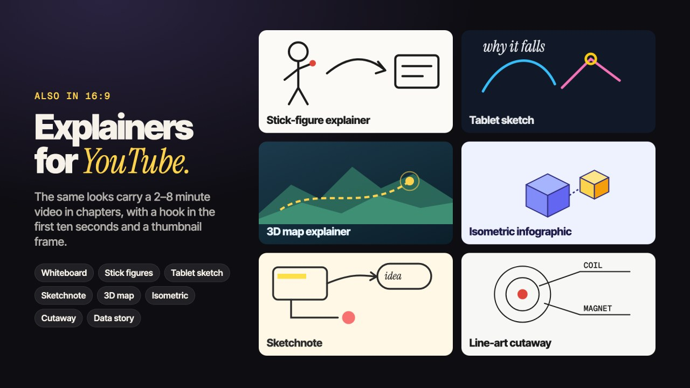](skills/3-styles-animated/film-styles/SKILL.md)

Every film look also makes a landscape explainer: 2–8 minutes in chapters, a hook in
the first ten seconds, a re-hook every half minute and a thumbnail frame. Start with
the whiteboard, stick-figure, tablet-sketch, sketchnote and marker explainers, Scale
Zoom, the 3D Map Explainer, Isometric Infographic, Line-Art Cutaway or Data Storytelling.

### Characters: a presenter for any reel

[`skills/3-styles-characters/`](skills/3-styles-characters)

<table><tr>
<td width="33%" valign="top"><a href="skills/3-styles-characters/cartoon-character/SKILL.md">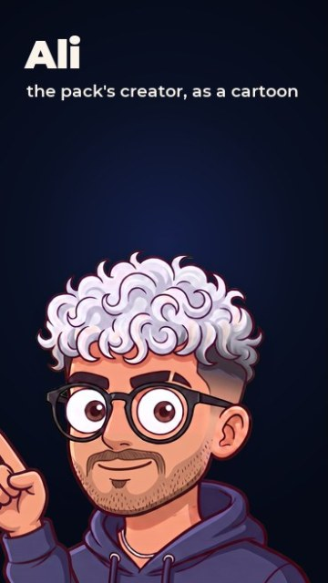</a><br><b><a href="skills/3-styles-characters/cartoon-character/SKILL.md">cartoon-character</a></b><br><sub>A lip-synced 2D cartoon that talks, blinks and swaps poses. Two samples ship (Ali and Stashy); make your own from a few photos with any image AI.</sub></td>
<td width="33%" valign="top"><a href="skills/3-styles-characters/3d-character/SKILL.md">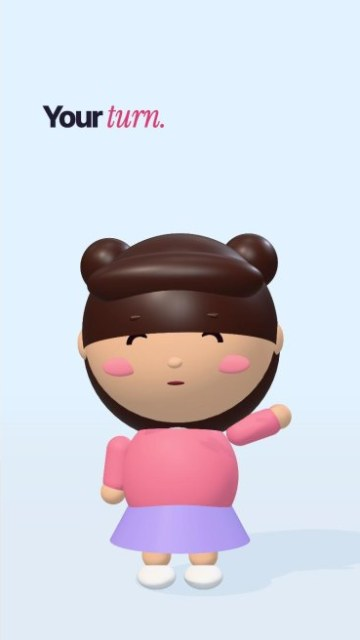</a><br><b><a href="skills/3-styles-characters/3d-character/SKILL.md">3d-character</a></b><br><sub>A cute 3D chibi boy or girl talks to camera on a pastel stage, with camera cuts on the words. Built in Three.js, no Blender needed.</sub></td>
<td width="33%" valign="top"></td>
</tr></table>

### On camera: you, or your footage

[`skills/3-styles-on-camera/`](skills/3-styles-on-camera)

<table><tr>
<td width="20%" valign="top"><a href="skills/3-styles-on-camera/breakout-card/SKILL.md">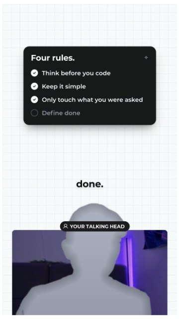</a><br><b><a href="skills/3-styles-on-camera/breakout-card/SKILL.md">breakout-card</a></b><br><sub>Your head breaks out of a card at the bottom; one-to-two-word captions.</sub></td>
<td width="20%" valign="top"><a href="skills/3-styles-on-camera/paper-grid/SKILL.md">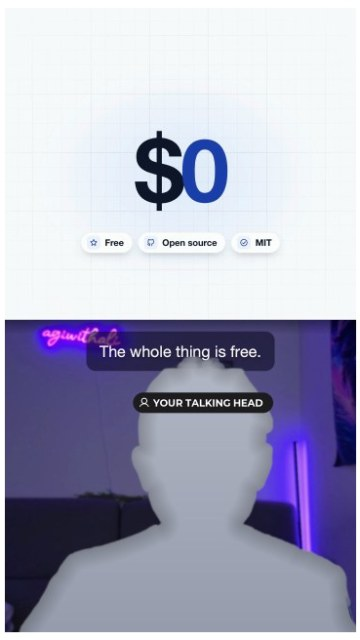</a><br><b><a href="skills/3-styles-on-camera/paper-grid/SKILL.md">paper-grid</a></b><br><sub>A white grid pane, one animated UI artifact per line.</sub></td>
<td width="20%" valign="top"><a href="skills/3-styles-on-camera/adaptive-glass/SKILL.md">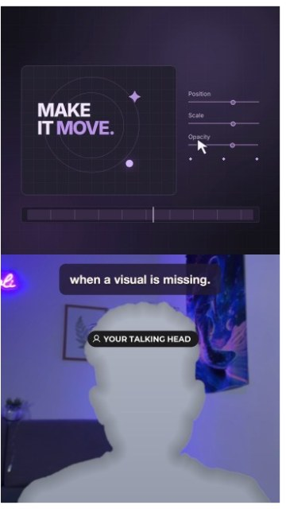</a><br><b><a href="skills/3-styles-on-camera/adaptive-glass/SKILL.md">adaptive-glass</a></b><br><sub>Moving proof in glass panels, coloured to match your footage.</sub></td>
<td width="20%" valign="top"><a href="skills/3-styles-on-camera/motion-effects/SKILL.md">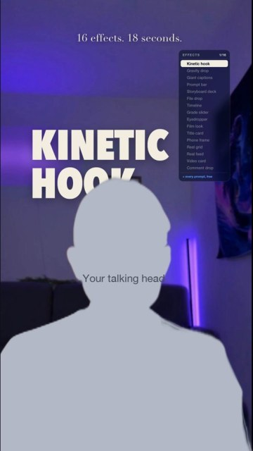</a><br><b><a href="skills/3-styles-on-camera/motion-effects/SKILL.md">motion-effects</a></b><br><sub>33 named effects for any talking head: kinetic hook, gravity drop, orbit, vertigo, rewind…</sub></td>
<td width="20%" valign="top"><a href="skills/3-styles-on-camera/text-over-footage/SKILL.md">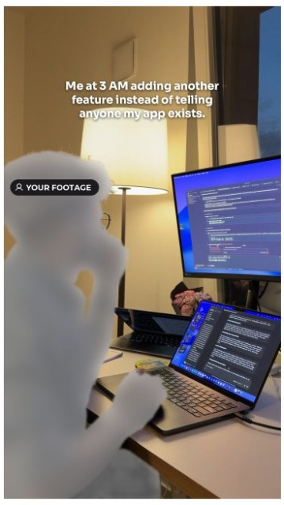</a><br><b><a href="skills/3-styles-on-camera/text-over-footage/SKILL.md">text-over-footage</a></b><br><sub>One readable line over B-roll that matches the joke.</sub></td>
</tr></table>

## One sentence is enough

```text
Use $film-styles with $edit-video to make a 30-second reel in the Whiteboard style
about how a credit score works, with a free local voice.
```

```text
Use $film-styles with $edit-video to make a 5-minute Stick-figure Explainer for YouTube
on why planes fly, in chapters, with a thumbnail.
```

```text
Use $film-styles with $edit-video to turn this report into a Caption News reel
that works with the sound off.
```

```text
Use $edit-video with $3d-character to make a 15-second 3D reel where the chibi girl
announces my launch, with camera cuts on the words and a wave at the end.
```

```text
Use $cartoon-character to make a cartoon of me from these three photos with my image
model, then use $animated-explainer to turn this script into a reel with it as the cursor.
```

```text
Use $edit-video with $product-motion-ads to make a 25-second ad for my app from its code,
ending on "comment TEMPLATE".
```

```text
Use $edit-video with $breakout-card to edit these takes into a 40-second reel, and add
a kinetic hook from $motion-effects.
```

## Voices: yours, free on your laptop, or hosted

Animated videos run on a voice, and every word's timing comes back with it, so each
card, click and sound lands on the word it belongs to.

| Voice | Cost | What you get |
| --- | --- | --- |
| Your own recording | Free | The default: a take per line, in your voice |
| [Chatterbox](https://github.com/resemble-ai/chatterbox) | Free, on your machine | Clones your voice from a ~10 s sample. MIT; Resemble AI stopped updating it in August 2026, but it still runs |
| Kokoro, through `hyperframes tts` | Free, on your machine | Twelve preset voices with nothing extra to sign up for. Apache-2.0 |
| [ElevenLabs](https://elevenlabs.io) | Paid per character | The most natural read, voice clones and exact word timings |

Clone only your own voice, or one you have permission to use. Setup and examples are
in [voice options](skills/3-editing/edit-video/references/voice.md).

## The creator loop

The styles are stage 3. The other stages find the idea, write the script and learn
from what you post.

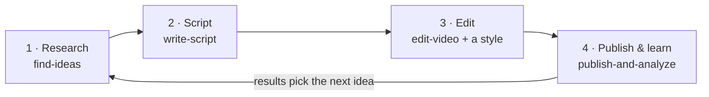

| Stage | Skill | What your agent does |
| --- | --- | --- |
| 1 · Research | [find-ideas](skills/1-research/find-ideas/SKILL.md) | Finds proven reels to adapt (3× their creator's median), reads saved inspiration and suggests what to make next |
| 2 · Script | [write-script](skills/2-scripting/write-script/SKILL.md) | Copies the proven hook, adds as many equally aggressive alternatives as you want to test, writes one shared body in your voice and hands over a filmable brief |
| 3 · Edit | [edit-video](skills/3-editing/edit-video/SKILL.md) + a style | Cuts your takes or builds the animated video, adds captions, sound and motion graphics, keeps everything in safe areas and reviews the actual export |
| 4 · Publish & learn | [publish-and-analyze](skills/4-publish-and-learn/publish-and-analyze/SKILL.md) | Exports at full quality, picks a real-frame cover, avoids duplicate holds on hook variants, schedules after your approval and compares results |

```text
Use $find-ideas to find three proven reels about AI coding tools I could adapt.
Use $write-script to adapt this reel into a few hooks to test and one body in my voice.
Use $publish-and-analyze to prepare covers and a caption for this cut, then compare
last week's hook test once I approve.
```

Every skill works on its own. [FavStash](https://www.favstash.app/) closes the loop:
your saved reels feed research, approved cuts go to Instagram, TikTok, YouTube or
LinkedIn, and the analytics pick the next test.

[](https://www.favstash.app/)

## Install

Paste the prompt at the top into Claude Code, Codex, Cursor or another local coding
agent. It follows [INSTALL_FOR_AGENTS.md](INSTALL_FOR_AGENTS.md) to install the skills,
prepare FFmpeg, HyperFrames and GSAP in your workspace, render a smoke test and
connect FavStash. You only sign in; the agent does the rest.

<details>
<summary>Install the skills yourself</summary>

```bash
npx skills add https://github.com/alisadiq-ai/favstash-ai-video-editing-skills
```

Add `--skill edit-video --skill film-styles` (for example) to pick skills. The
[agent setup guide](INSTALL_FOR_AGENTS.md) covers media tools and the FavStash connection.

For Claude Code or Codex, the FavStash CLI connects your stash and uploads local files:

```bash
npm install -g @sketric/favstash-mcp@latest
favstash auth login
favstash setup --agent claude-code
favstash doctor
```

Use `--agent codex` for Codex. Other agents connect through FavStash's MCP server
with OAuth ([connection guide](https://www.favstash.app/docs/ai-connect)).

</details>

<details>
<summary>Install as a Claude plugin</summary>

This repository is also a Claude plugin, `favstash-creator-skills`, with all fourteen
skills and the FavStash connector. Load it in Claude Code for one session:

```bash
claude --plugin-dir ./favstash-ai-video-editing-skills
```

Skills are namespaced under the plugin, for example
`/favstash-creator-skills:edit-video`, and Claude also picks them up when your
request fits. Connect FavStash from the plugin's connectors with OAuth. The editing
skills need the local media tools in the [agent setup guide](INSTALL_FOR_AGENTS.md),
so use the plugin in Claude Code or in Cowork on your own computer.

</details>

## Free to use

The skills are free and open source (Apache-2.0). FavStash's free plan includes
unlimited saved items and stash searches, 100 transcript and AI enrichments, one
connected channel and 10 posts a month. See the [current plans](https://www.favstash.app/#pricing).

## FAQ

**Do I need FavStash?** No. Research, scripting and editing work without it. FavStash
adds your saved inspiration, scheduling and analytics so the loop closes.

**Will my agent post without asking?** No. It delivers a local file. Posting needs your
approval for the exact file, cover, caption, account and time.

**How long does a film-style video take?** The agent writes a treatment, draws two or
three style frames for you to check, then builds and renders. Expect an agent session
of about half an hour for a 30-second reel, longer for a YouTube explainer, plus the
render (about ten seconds of rendering per second of video).

**Does it make YouTube videos?** Yes. Every film look has a 16:9 format for 2–8 minute
explainers in chapters, with the first ten seconds and the thumbnail planned. The other
styles are built for 9:16; `product-motion-ads` also cuts a 16:9 launch film.

**What runs where?** Editing runs locally with FFmpeg and HyperFrames (Node 22+).
`paper-grid`, `breakout-card`, `animated-explainer`, `3d-character`, `cartoon-character`
and the duplicate check also use Python. The
breakout card's built-in person matte uses Apple Vision on macOS; on other systems,
supply a matte from any segmentation tool.

**What does it send, and where?** The bundled scripts run on your machine and make no
network requests; your footage, renders and preferences stay in your workspace.
Data leaves your machine only through FavStash tools you connect: the remote MCP
server at `https://mcp.favstash.app/mcp` (OAuth) or the FavStash CLI. They search
your stash, read your connected accounts' analytics, and upload and schedule a
post only after you approve the exact file, caption, account and time. See the
[FavStash privacy policy](https://www.favstash.app/privacy).

**Can I use Ali's cartoon or Stashy?** To try and demo the skills, yes. For your own
channel, make your own character; the samples' [terms](skills/3-styles-characters/cartoon-character/characters/README.md)
say what's allowed.

**Can I use a saved reel as a reference?** Yes, for analysis. Adapt its hook,
structure and pacing, and make the video from your own footage. Downloaded footage
and music stay analysis-only unless you have reuse rights.

## Contributing

```bash
npm test
npm run validate
```

See [contributing](CONTRIBUTING.md) and [security](SECURITY.md). Code, instructions
and original SFX use [Apache-2.0](LICENSE); external tools, the bundled fonts, the
film-style guides and the sample characters keep their own [licenses](THIRD_PARTY_NOTICES.md).
Most style previews come from the maintainer's own reels, with the speaker replaced
by a placeholder; the animated previews are reels the skills built from their own
worked examples. If this pack saves you an edit, a ⭐ helps other creators find it.
