<p align="center">
  <a href="https://www.favstash.app/?utm_source=github&utm_medium=referral&utm_campaign=creator-skills-global-q4&utm_content=readme-logo">
    
  </a>
</p>

<h1 align="center">FavStash Creator Skills</h1>

<p align="center">
  <strong>Turn Claude Code or Codex into a video studio.</strong><br />
  Tell your agent what you want, and it makes and posts the whole video on your machine:<br />
  Reels, TikToks, Shorts and YouTube explainers. Free and open source.
</p>

<p align="center">
  <a href="https://github.com/alisadiq-ai/favstash-ai-video-editing-skills/stargazers"></a>
  <a href="LICENSE"></a>
  
  
</p>

<p align="center">
  <br />
  <a href="#install"><strong>Install in one prompt »</strong></a>
  <br /><br />
  <a href="skills/3-styles-animated/film-styles/styles/README.md"><strong>Browse all 99 film looks »</strong></a>
  <br /><br />
</p>

<p align="center">
  <a href="#pick-a-style">Pick a style</a>
  ·
  <a href="#clip-a-stream">Clip a stream</a>
  ·
  <a href="#voices">Voices</a>
  ·
  <a href="#the-creator-loop">Creator loop</a>
  ·
  <a href="#privacy">Privacy</a>
  ·
  <a href="#faq">FAQ</a>
  ·
  <a href="https://www.favstash.app/?utm_source=github&utm_medium=referral&utm_campaign=creator-skills-global-q4&utm_content=readme-nav">FavStash</a>
</p>

<p align="center"><strong>Works with your agent:</strong></p>
<p align="center">
  
  
  
  
</p>

<p align="center"><strong>Publish with <a href="https://www.favstash.app/?utm_source=github&utm_medium=referral&utm_campaign=creator-skills-global-q4&utm_content=readme-publish-row">FavStash</a> to:</strong></p>
<p align="center">
  
  
  
  
</p>

<br />

<p align="center">
  <a href="#pick-a-style">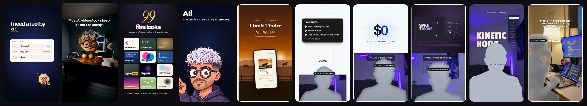</a>
</p>

## ✨ What you get

No camera, no video model, no stock footage, no subscription.

- 🎬 **99 film looks**: whiteboard, stick figures, cel anime, manga, newsreel, 3D maps, tilt-shift, risograph and more. Each is a full style guide: layout, type, motion, camera, sound and the first frame.
- 📺 **Reels and YouTube**: every look comes as a 9:16 reel and a 16:9 explainer in chapters.
- 🧸 **Characters**: a chibi 3D kid, a Blender sitcom your agent directs from a script, or a lip-synced cartoon of you made from a few photos.
- 🎙️ **Free voices**: your own recording, a free local voice, or ElevenLabs, with every word timed.
- ✂️ **Clip your streams**: hand it a four-hour VOD or a live link; it finds the best moments and cuts them into 9:16 clips.
- 🔁 **The whole loop**: find proven ideas, write the script, edit, then publish and learn with [FavStash](https://www.favstash.app/?utm_source=github&utm_medium=referral&utm_campaign=creator-skills-global-q4&utm_content=readme-features).

<a id="install"></a>

## ⚡ Install in one prompt

Paste this into Claude Code, Codex, Cursor or another local coding agent. It installs all sixteen skills and the media tools they need, renders a test video and connects FavStash. You only sign in.

```text
Set up FavStash creator skills for my short-form workflow.
Clone https://github.com/alisadiq-ai/favstash-ai-video-editing-skills and follow:
https://raw.githubusercontent.com/alisadiq-ai/favstash-ai-video-editing-skills/main/INSTALL_FOR_AGENTS.md

Install all sixteen skills and the local media tools they need in my workspace.
Check whether FavStash is connected; if not, connect it with the FavStash CLI
(Codex or Claude Code) or guide me through sign-in. Verify the setup, then tell
me how to start my first reel.
```

<sub>Prefer to do it yourself? See [other ways to install](#other-ways-to-install): `npx skills` or the Claude plugin.</sub>

<a id="pick-a-style"></a>

## 🎬 Pick a style

[`edit-video`](skills/3-editing/edit-video/SKILL.md) is the base for every edit: the cut, captions, voice, sound and review. Add one style on top. The styles sit on three shelves.

### No camera: fully animated

<table><tr>
<td width="33%" valign="top" align="center"><a href="skills/3-styles-animated/film-styles/SKILL.md">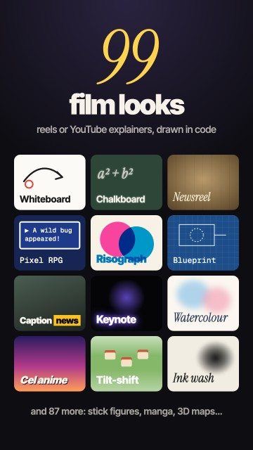</a><br><b><a href="skills/3-styles-animated/film-styles/SKILL.md">film-styles</a></b><br><sub>99 film looks for reels and YouTube. Name one, bring a story.</sub></td>
<td width="33%" valign="top" align="center"><a href="skills/3-styles-animated/animated-explainer/SKILL.md">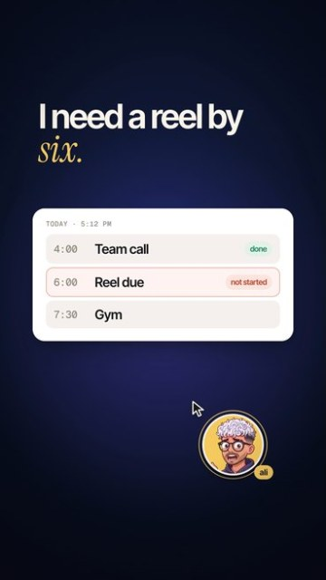</a><br><b><a href="skills/3-styles-animated/animated-explainer/SKILL.md">animated-explainer</a></b><br><sub>A reel keyed to the voice, one hero card per beat.</sub></td>
<td width="33%" valign="top" align="center"><a href="skills/3-styles-animated/product-motion-ads/SKILL.md">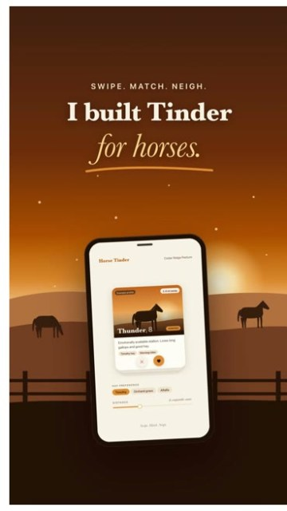</a><br><b><a href="skills/3-styles-animated/product-motion-ads/SKILL.md">product-motion-ads</a></b><br><sub>A motion ad built from your own product.</sub></td>
</tr></table>

### Characters: a presenter for any reel

<table><tr>
<td width="33%" valign="top" align="center"><a href="skills/3-styles-characters/cartoon-character/SKILL.md">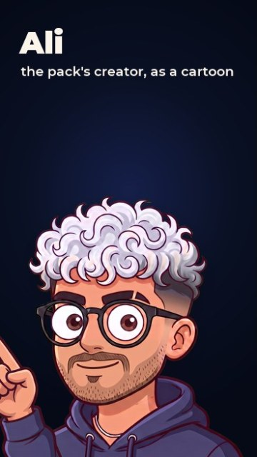</a><br><b><a href="skills/3-styles-characters/cartoon-character/SKILL.md">cartoon-character</a></b><br><sub>A lip-synced cartoon of you, made from a few photos.</sub></td>
<td width="33%" valign="top" align="center"><a href="skills/3-styles-characters/3d-character/SKILL.md">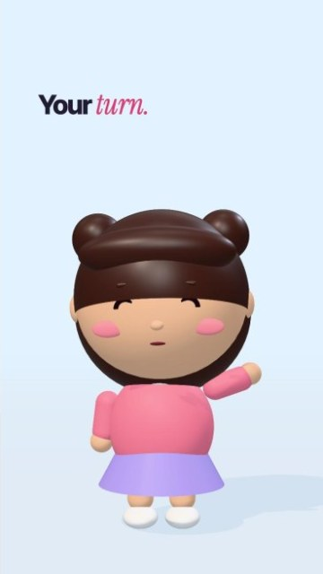</a><br><b><a href="skills/3-styles-characters/3d-character/SKILL.md">3d-character</a></b><br><sub>A chibi 3D presenter, camera cuts on the words.</sub></td>
<td width="33%" valign="top" align="center"><a href="skills/3-styles-characters/blender-director/SKILL.md">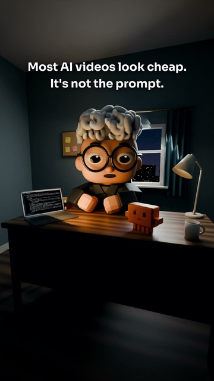</a><br><b><a href="skills/3-styles-characters/blender-director/SKILL.md">blender-director</a></b><br><sub>A narrated 3D episode built in Blender from code.</sub></td>
</tr></table>

### On camera: you, or your footage

<table><tr>
<td width="20%" valign="top" align="center"><a href="skills/3-styles-on-camera/breakout-card/SKILL.md">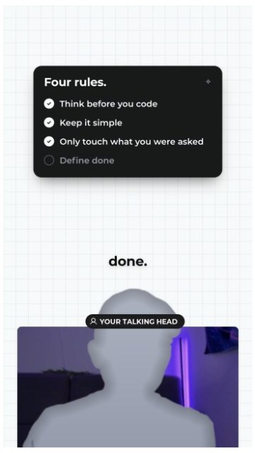</a><br><b><a href="skills/3-styles-on-camera/breakout-card/SKILL.md">breakout-card</a></b><br><sub>Your head breaks out of a card.</sub></td>
<td width="20%" valign="top" align="center"><a href="skills/3-styles-on-camera/paper-grid/SKILL.md">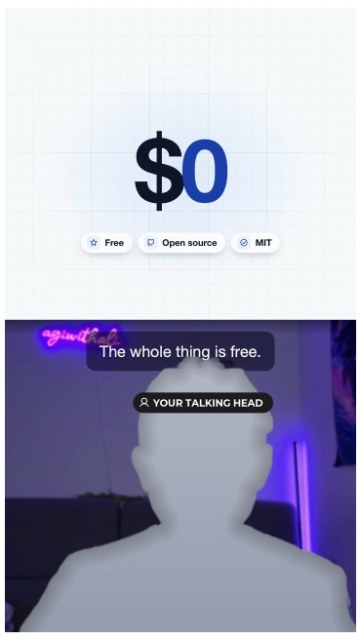</a><br><b><a href="skills/3-styles-on-camera/paper-grid/SKILL.md">paper-grid</a></b><br><sub>One animated UI per line.</sub></td>
<td width="20%" valign="top" align="center"><a href="skills/3-styles-on-camera/adaptive-glass/SKILL.md">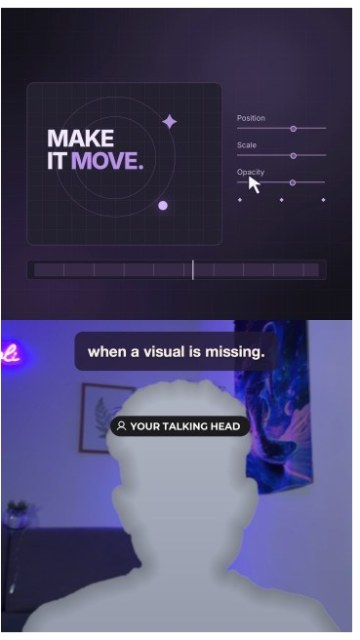</a><br><b><a href="skills/3-styles-on-camera/adaptive-glass/SKILL.md">adaptive-glass</a></b><br><sub>Proof in glass panels.</sub></td>
<td width="20%" valign="top" align="center"><a href="skills/3-styles-on-camera/motion-effects/SKILL.md">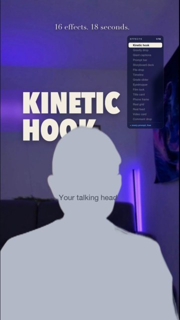</a><br><b><a href="skills/3-styles-on-camera/motion-effects/SKILL.md">motion-effects</a></b><br><sub>33 named effects.</sub></td>
<td width="20%" valign="top" align="center"><a href="skills/3-styles-on-camera/text-over-footage/SKILL.md">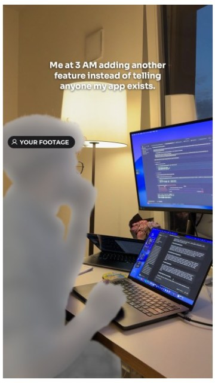</a><br><b><a href="skills/3-styles-on-camera/text-over-footage/SKILL.md">text-over-footage</a></b><br><sub>One line over B-roll.</sub></td>
</tr></table>

<a id="film-looks"></a>

## 🎞️ 99 film looks, for Reels and YouTube

[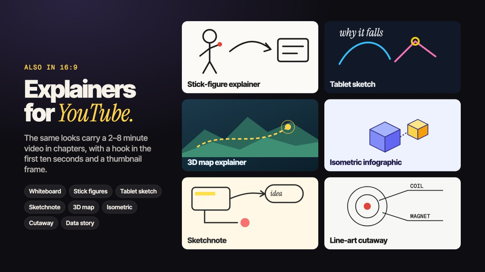](skills/3-styles-animated/film-styles/SKILL.md)

Every look makes a 9:16 reel and a 16:9 YouTube explainer: 2–8 minutes in chapters, a hook in the first ten seconds, a re-hook every half minute and a thumbnail frame. For YouTube, start with Whiteboard, Stick-figure, Tablet Sketch, Sketchnote, Scale Zoom, 3D Map Explainer, Isometric Infographic, Line-Art Cutaway or Data Storytelling. The [style index](skills/3-styles-animated/film-styles/styles/README.md) says what each look is good for.

<details>
<summary><b>See all 99 looks by group</b></summary>

<!-- film-looks:start -->
| Group | Looks |
| --- | --- |
| Edit & documentary | [1920s Newsreel](skills/3-styles-animated/film-styles/styles/01-edit-documentary/newsreel/STYLE.md), [Broadcast News Package](skills/3-styles-animated/film-styles/styles/01-edit-documentary/news-package/STYLE.md), [Caption News](skills/3-styles-animated/film-styles/styles/01-edit-documentary/caption-news/STYLE.md), [Constructivist Montage](skills/3-styles-animated/film-styles/styles/01-edit-documentary/kino-montage/STYLE.md), [Live Countdown Split-screen](skills/3-styles-animated/film-styles/styles/01-edit-documentary/countdown/STYLE.md), [Sports Telestrator](skills/3-styles-animated/film-styles/styles/01-edit-documentary/telestrator/STYLE.md), [Time-lapse Symphony](skills/3-styles-animated/film-styles/styles/01-edit-documentary/city-symphony/STYLE.md), [Visual Investigation](skills/3-styles-animated/film-styles/styles/01-edit-documentary/visual-investigation/STYLE.md) |
| Painting & illustration | [Colored-Pencil Science Illustration](skills/3-styles-animated/film-styles/styles/02-painting/colored-pencil/STYLE.md), [Crayon Picture Book](skills/3-styles-animated/film-styles/styles/02-painting/crayon-book/STYLE.md), [Impasto Oil Painting](skills/3-styles-animated/film-styles/styles/02-painting/impasto/STYLE.md), [Urban Sketch · Pen & Wash](skills/3-styles-animated/film-styles/styles/02-painting/urban-sketch/STYLE.md), [Watercolor Brush](skills/3-styles-animated/film-styles/styles/02-painting/watercolor/STYLE.md) |
| Sketch & board | [Chalkboard](skills/3-styles-animated/film-styles/styles/03-sketch-board/chalkboard/STYLE.md), [Marker on Paper](skills/3-styles-animated/film-styles/styles/03-sketch-board/marker-paper/STYLE.md), [One-line Drawing](skills/3-styles-animated/film-styles/styles/03-sketch-board/one-line/STYLE.md), [Sketchnote](skills/3-styles-animated/film-styles/styles/03-sketch-board/sketchnote/STYLE.md), [Stick-figure Explainer](skills/3-styles-animated/film-styles/styles/03-sketch-board/stick-explainer/STYLE.md), [Tablet Sketch Explainer](skills/3-styles-animated/film-styles/styles/03-sketch-board/ipad-sketch/STYLE.md), [Whiteboard Explainer](skills/3-styles-animated/film-styles/styles/03-sketch-board/whiteboard/STYLE.md) |
| Traditional crafts | [Chinese Ink Wash](skills/3-styles-animated/film-styles/styles/04-traditional-crafts/ink-wash/STYLE.md), [Gilded Illumination](skills/3-styles-animated/film-styles/styles/04-traditional-crafts/gilded-illumination/STYLE.md), [Paper-cut Lightbox](skills/3-styles-animated/film-styles/styles/04-traditional-crafts/paper-lantern/STYLE.md), [Red Paper-cut](skills/3-styles-animated/film-styles/styles/04-traditional-crafts/papercut-red/STYLE.md), [Shadow Puppetry](skills/3-styles-animated/film-styles/styles/04-traditional-crafts/shadow-puppet/STYLE.md), [Stained Glass](skills/3-styles-animated/film-styles/styles/04-traditional-crafts/stained-glass/STYLE.md), [Ukiyo-e](skills/3-styles-animated/film-styles/styles/04-traditional-crafts/ukiyoe/STYLE.md) |
| Print | [Copperplate Engraving](skills/3-styles-animated/film-styles/styles/05-print/engraving/STYLE.md), [Halftone Dossier](skills/3-styles-animated/film-styles/styles/05-print/halftone-dossier/STYLE.md), [Pop Art](skills/3-styles-animated/film-styles/styles/05-print/pop-art/STYLE.md), [Printed Long Take](skills/3-styles-animated/film-styles/styles/05-print/printed-long-take/STYLE.md), [Risograph Print](skills/3-styles-animated/film-styles/styles/05-print/risograph/STYLE.md), [Silkscreen Travel Poster](skills/3-styles-animated/film-styles/styles/05-print/silkscreen-poster/STYLE.md), [Vintage Engraving Collage](skills/3-styles-animated/film-styles/styles/05-print/vintage-collage/STYLE.md), [Woodcut Print](skills/3-styles-animated/film-styles/styles/05-print/woodcut/STYLE.md) |
| Graphic & type | [60s Spy Title Sequence](skills/3-styles-animated/film-styles/styles/06-graphic-type/spy-titles/STYLE.md), [Art Deco](skills/3-styles-animated/film-styles/styles/06-graphic-type/art-deco/STYLE.md), [Bauhaus Shapes](skills/3-styles-animated/film-styles/styles/06-graphic-type/bauhaus-shapes/STYLE.md), [Pictogram Motion](skills/3-styles-animated/film-styles/styles/06-graphic-type/pictogram-motion/STYLE.md), [Scale Zoom Explainer](skills/3-styles-animated/film-styles/styles/06-graphic-type/flat-space-explainer/STYLE.md), [Silhouette Rhythm](skills/3-styles-animated/film-styles/styles/06-graphic-type/silhouette-rhythm/STYLE.md), [Swiss Motion Graphics](skills/3-styles-animated/film-styles/styles/06-graphic-type/swiss-motion/STYLE.md), [Text Flash Cuts](skills/3-styles-animated/film-styles/styles/06-graphic-type/text-flash-cuts/STYLE.md) |
| Line diagrams | [Assembly-Line Diagram](skills/3-styles-animated/film-styles/styles/07-line-diagrams/assembly-line-diagram/STYLE.md), [Blueprint](skills/3-styles-animated/film-styles/styles/07-line-diagrams/blueprint/STYLE.md), [Color-Coded Mechanism](skills/3-styles-animated/film-styles/styles/07-line-diagrams/precise-mechanism/STYLE.md), [Exploded Teardown](skills/3-styles-animated/film-styles/styles/07-line-diagrams/teardown/STYLE.md), [Instruction Manual Art](skills/3-styles-animated/film-styles/styles/07-line-diagrams/instruction-manual/STYLE.md), [Isometric Infographic](skills/3-styles-animated/film-styles/styles/07-line-diagrams/iso-infographic/STYLE.md), [Line-Art Cutaway](skills/3-styles-animated/film-styles/styles/07-line-diagrams/hardcore-info/STYLE.md), [Pen Plotter](skills/3-styles-animated/film-styles/styles/07-line-diagrams/pen-plotter/STYLE.md) |
| Cartoons | [1930s Rubber Hose Cartoon](skills/3-styles-animated/film-styles/styles/08-cartoons/rubber-hose/STYLE.md), [80s Cel Anime](skills/3-styles-animated/film-styles/styles/08-cartoons/cel-anime-80s/STYLE.md), [Comic History Cartoon](skills/3-styles-animated/film-styles/styles/08-cartoons/comic-history/STYLE.md), [Manga Panels](skills/3-styles-animated/film-styles/styles/08-cartoons/manga-panels/STYLE.md), [Mid-century Cartoon](skills/3-styles-animated/film-styles/styles/08-cartoons/midcentury-toon/STYLE.md), [Sci-Fi Sitcom Toon](skills/3-styles-animated/film-styles/styles/08-cartoons/scifi-toon/STYLE.md) |
| Games | [16-bit Pixel RPG](skills/3-styles-animated/film-styles/styles/09-games/pixel-rpg/STYLE.md), [Game Show Flat](skills/3-styles-animated/film-styles/styles/09-games/game-show/STYLE.md), [HD-2D](skills/3-styles-animated/film-styles/styles/09-games/hd-2d/STYLE.md), [Microgame Frenzy](skills/3-styles-animated/film-styles/styles/09-games/microgame/STYLE.md) |
| Film & tape | [1920s Silent Film](skills/3-styles-animated/film-styles/styles/10-film-tape/silent-film/STYLE.md), [ASCII / CRT Terminal](skills/3-styles-animated/film-styles/styles/10-film-tape/ascii-crt/STYLE.md), [Double Exposure](skills/3-styles-animated/film-styles/styles/10-film-tape/double-exposure/STYLE.md), [Liminal Found Footage](skills/3-styles-animated/film-styles/styles/10-film-tape/backrooms/STYLE.md), [Scratch Film](skills/3-styles-animated/film-styles/styles/10-film-tape/scratch-film/STYLE.md) |
| Screens & interfaces | [1-bit Dither](skills/3-styles-animated/film-styles/styles/11-screens/one-bit-dither/STYLE.md), [Dark Tech Keynote](skills/3-styles-animated/film-styles/styles/11-screens/dark-keynote/STYLE.md), [Desktop Flythrough](skills/3-styles-animated/film-styles/styles/11-screens/desktop-flythrough/STYLE.md), [Living Screencast](skills/3-styles-animated/film-styles/styles/11-screens/living-screencast/STYLE.md), [Sci-fi Hologram HUD](skills/3-styles-animated/film-styles/styles/11-screens/hologram-hud/STYLE.md), [Spreadsheet Film](skills/3-styles-animated/film-styles/styles/11-screens/spreadsheet/STYLE.md) |
| Light & lines | [Circuit Board](skills/3-styles-animated/film-styles/styles/12-light-lines/circuit-board/STYLE.md), [Firefly Pointillism](skills/3-styles-animated/film-styles/styles/12-light-lines/firefly-pointillism/STYLE.md), [Flow-field Wind Lines](skills/3-styles-animated/film-styles/styles/12-light-lines/flow-field/STYLE.md), [Neon Tubes](skills/3-styles-animated/film-styles/styles/12-light-lines/neon-tubes/STYLE.md), [Oscilloscope Math](skills/3-styles-animated/film-styles/styles/12-light-lines/oscilloscope-math/STYLE.md) |
| 3D & miniature | [Brick Toy](skills/3-styles-animated/film-styles/styles/13-3d-miniature/brick-toy/STYLE.md), [Crayon World 3D](skills/3-styles-animated/film-styles/styles/13-3d-miniature/crayon-world/STYLE.md), [Glass Product Render](skills/3-styles-animated/film-styles/styles/13-3d-miniature/glass-product/STYLE.md), [Isometric Picture Book](skills/3-styles-animated/film-styles/styles/13-3d-miniature/isometric-picture-book/STYLE.md), [Low-poly Isometric Island](skills/3-styles-animated/film-styles/styles/13-3d-miniature/lowpoly-island/STYLE.md), [Memphis Diorama](skills/3-styles-animated/film-styles/styles/13-3d-miniature/memphis-diorama/STYLE.md), [Paper Pop-up Book](skills/3-styles-animated/film-styles/styles/13-3d-miniature/paper-popup/STYLE.md), [Tilt-Shift Miniature](skills/3-styles-animated/film-styles/styles/13-3d-miniature/tilt-shift/STYLE.md) |
| Instruments & evidence | [Archive Light Table](skills/3-styles-animated/film-styles/styles/14-instruments/archive-lighttable/STYLE.md), [Engineering Briefing Board](skills/3-styles-animated/film-styles/styles/14-instruments/briefing-board/STYLE.md), [LiDAR Survey](skills/3-styles-animated/film-styles/styles/14-instruments/lidar-survey/STYLE.md), [Microscope Story](skills/3-styles-animated/film-styles/styles/14-instruments/microscope/STYLE.md), [Radar Sweep Documentary](skills/3-styles-animated/film-styles/styles/14-instruments/dark-documentary/STYLE.md), [Satellite Briefing](skills/3-styles-animated/film-styles/styles/14-instruments/satellite-briefing/STYLE.md), [Security X-ray](skills/3-styles-animated/film-styles/styles/14-instruments/security-xray/STYLE.md), [Thermal Camera](skills/3-styles-animated/film-styles/styles/14-instruments/thermal-camera/STYLE.md) |
| Data & maps | [3D Map Explainer](skills/3-styles-animated/film-styles/styles/15-data-maps/map-explainer/STYLE.md), [Blob Simulation](skills/3-styles-animated/film-styles/styles/15-data-maps/pip-simulation/STYLE.md), [Data Physicalization](skills/3-styles-animated/film-styles/styles/15-data-maps/data-physical/STYLE.md), [Data Storytelling](skills/3-styles-animated/film-styles/styles/15-data-maps/dataviz/STYLE.md), [Projection on White Model](skills/3-styles-animated/film-styles/styles/15-data-maps/white-model/STYLE.md), [Transit Map](skills/3-styles-animated/film-styles/styles/15-data-maps/transit-map/STYLE.md) |
<!-- film-looks:end -->

</details>

## 💬 One sentence is enough

```text
Use $film-styles with $edit-video to make a 30-second reel in the Whiteboard style
about how a credit score works, with a free local voice.
```

```text
Use $edit-video with $3d-character to make a 15-second 3D reel where the chibi girl
announces my launch, with camera cuts on the words and a wave at the end.
```

```text
Use $edit-video with $breakout-card to edit these takes into a 40-second reel, and add
a kinetic hook from $motion-effects.
```

<details>
<summary><b>More examples</b></summary>

```text
Use $film-styles with $edit-video to make a 5-minute Stick-figure Explainer for YouTube
on why planes fly, in chapters, with a thumbnail.
```

```text
Use $film-styles with $edit-video to turn this report into a Caption News reel
that works with the sound off.
```

```text
Use $blender-director to turn this two-character script into a 3D episode in Blender,
in a dark night room, with a wireframe reveal on the line "this whole room is code".
```

```text
Use $cartoon-character to make a cartoon of me from these three photos with my image
model, then use $animated-explainer to turn this script into a reel with it as the cursor.
```

```text
Use $edit-video with $product-motion-ads to make a 25-second ad for my app from its code,
ending on "comment TEMPLATE".
```

</details>

<a id="clip-a-stream"></a>

## ✂️ Clip a stream

[`clip-stream`](skills/3-editing/clip-stream/SKILL.md) turns a long stream, VOD or gameplay recording into vertical clips. It finds the moments worth posting from volume spikes, what you say ("no way", "clip that", your own keywords), chat bursts and hard cuts on screen. You check each pick, keep the good ones, and it cuts them to 1080×1920:

| Layout | Looks like | Fits |
| --- | --- | --- |
| `center` | A 9:16 window cut from the frame, slid left or right per clip | Driving, action, one clear subject |
| `fill` | The whole frame over a blurred copy of itself | Games where the HUD, minimap or kill feed matters |
| `split` | Your facecam on top, the game below | Streams where your reaction is half the moment |

It can also clip a stream while it's live: paste the link and it records, reads chat and cuts a clip every time the chat goes off (Twitch through streamlink, so ads are skipped and chat stays in sync). Everything runs on your computer with FFmpeg and a free local transcriber.

```text
Use $clip-stream to find the 30 best moments in last night's stream, show me the picks,
then cut the ones I keep with my facecam on top.
```

<sub>Clip your own streams, or streams whose owner lets you clip them.</sub>

<a id="voices"></a>

## 🎙️ Voices: yours, free on your laptop, or hosted

Every word's timing comes back with the voice, so each card, click and sound lands on the word it belongs to.

| Voice | Cost | What you get |
| --- | --- | --- |
| Your own recording | Free | The default: a take per line, in your voice |
| [Chatterbox](https://github.com/resemble-ai/chatterbox) | Free, on your machine | Clones your voice from a ~10 s sample. MIT; Resemble AI stopped updating it in August 2026, but it still runs |
| Kokoro, through `hyperframes tts` | Free, on your machine | Twelve preset voices with nothing extra to sign up for. Apache-2.0 |
| [ElevenLabs](https://elevenlabs.io) | Paid per character | The most natural read, voice clones and exact word timings; your agent sets it up with your own account |

<sub>Clone only your own voice, or one you have permission to use. Setup and examples: [voice options](skills/3-editing/edit-video/references/voice.md).</sub>

<a id="the-creator-loop"></a>

## 🔁 The creator loop

The styles are stage 3. The other stages find the idea, write the script and learn from what you post.

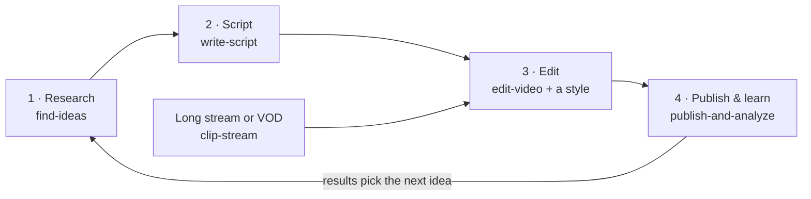

| Stage | Skill | What your agent does |
| --- | --- | --- |
| 1 · Research | [find-ideas](skills/1-research/find-ideas/SKILL.md) | Finds proven reels to adapt (3× their creator's median), reads saved inspiration and suggests what to make next |
| 2 · Script | [write-script](skills/2-scripting/write-script/SKILL.md) | Copies the proven hook, adds alternatives to test, writes one shared body in your voice and hands over a filmable brief |
| 3 · Clip | [clip-stream](skills/3-editing/clip-stream/SKILL.md) | Finds the best moments in a long stream or VOD and cuts the ones you keep into 9:16 clips |
| 3 · Edit | [edit-video](skills/3-editing/edit-video/SKILL.md) + a style | Cuts your takes or builds the animated video, adds captions, sound and motion graphics, and reviews the actual export |
| 4 · Publish & learn | [publish-and-analyze](skills/4-publish-and-learn/publish-and-analyze/SKILL.md) | Exports at full quality, picks a real-frame cover, schedules after your approval and compares results |

[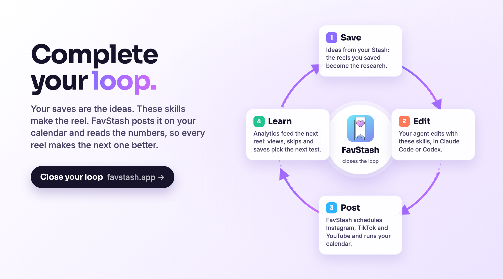](https://www.favstash.app/?utm_source=github&utm_medium=referral&utm_campaign=creator-skills-global-q4&utm_content=readme-loop)

<a id="compare"></a>

## 🆚 Skills alone, or with FavStash

Every skill works on its own. [FavStash](https://www.favstash.app/?utm_source=github&utm_medium=referral&utm_campaign=creator-skills-global-q4&utm_content=readme-compare) closes the loop.

| | Skills only | Skills + FavStash |
| --- | --- | --- |
| **Cost** | Free and open source (Apache-2.0) | The skills stay free; FavStash [plans](https://www.favstash.app/?utm_source=github&utm_medium=referral&utm_campaign=creator-skills-global-q4&utm_content=readme-pricing#pricing) |
| **Research** | Finds proven reels to adapt | Also reads the reels you saved to your stash |
| **Script and edit** | Runs on your laptop | Same |
| **Publishing** | You get a local file to post yourself | Schedules to Instagram, TikTok, YouTube or LinkedIn after you approve |
| **Learning** | You compare results by hand | Analytics compare your posts and pick the next test |
| **Setup** | Nothing to sign up for | Connect once with OAuth or the FavStash CLI |

<a id="privacy"></a>

## 🔒 Privacy and approvals

- The bundled scripts run on your machine and make no network requests. Your footage, renders and preferences stay in your workspace.
- Your agent delivers a local file. Nothing is posted until you approve the exact file, cover, caption, account and time.
- Data leaves your machine only through FavStash tools you connect: the remote MCP server at `https://mcp.favstash.app/mcp` (OAuth) or the FavStash CLI. See the [FavStash privacy policy](https://www.favstash.app/privacy).
- Saved reels are references: adapt their hook, structure and pacing, and make the video from your own footage. Downloaded footage and music stay analysis-only unless you have reuse rights.

<a id="other-ways-to-install"></a>

## 📦 Other ways to install

<details>
<summary>Install the skills yourself</summary>

```bash
npx skills add https://github.com/alisadiq-ai/favstash-ai-video-editing-skills
```

Add `--skill edit-video --skill film-styles` (for example) to pick skills. The
[agent setup guide](INSTALL_FOR_AGENTS.md) covers media tools and the FavStash connection.

For Claude Code or Codex, the FavStash CLI connects your stash and uploads local files:

```bash
npm install -g @sketric/favstash-mcp@latest
favstash auth login
favstash setup --agent claude-code
favstash doctor
```

Use `--agent codex` for Codex. Other agents connect through FavStash's MCP server
with OAuth ([connection guide](https://www.favstash.app/docs/ai-connect)).

</details>

<details>
<summary>Install as a Claude plugin</summary>

This repository is also a Claude plugin, `favstash-creator-skills`, with all sixteen
skills and the FavStash connector. Load it in Claude Code for one session:

```bash
claude --plugin-dir ./favstash-ai-video-editing-skills
```

Skills are namespaced under the plugin, for example
`/favstash-creator-skills:edit-video`, and Claude also picks them up when your
request fits. Connect FavStash from the plugin's connectors with OAuth. The editing
skills need the local media tools in the [agent setup guide](INSTALL_FOR_AGENTS.md),
so use the plugin in Claude Code or in Cowork on your own computer.

</details>

<a id="faq"></a>

## ❓ FAQ

<details>
<summary><b>Do I need FavStash?</b></summary>

No. Research, scripting and editing work without it. FavStash adds your saved inspiration, scheduling and analytics so the loop closes. See [skills alone, or with FavStash](#compare).

</details>

<details>
<summary><b>How long does a film-style video take?</b></summary>

The agent writes a treatment, draws two or three style frames for you to check, then builds and renders. Expect an agent session of about half an hour for a 30-second reel, longer for a YouTube explainer, plus the render (about ten seconds of rendering per second of video).

</details>

<details>
<summary><b>Does it make YouTube videos?</b></summary>

Yes. Every film look has a 16:9 format for 2–8 minute explainers in chapters, with the first ten seconds and the thumbnail planned. The other styles are built for 9:16; `product-motion-ads` also cuts a 16:9 launch film.

</details>

<details>
<summary><b>What runs where?</b></summary>

Editing runs locally with FFmpeg and HyperFrames (Node 22+). `paper-grid`, `breakout-card`, `animated-explainer`, `3d-character`, `cartoon-character` and the duplicate check also use Python. The breakout card's built-in person matte uses Apple Vision on macOS; on other systems, supply a matte from any segmentation tool.

</details>

<details>
<summary><b>Can I use Ali's cartoon or Stashy?</b></summary>

To try and demo the skills, yes. For your own channel, make your own character; the samples' [terms](skills/3-styles-characters/cartoon-character/characters/README.md) say what's allowed.

</details>

## 🤝 Contributing

```bash
npm test
npm run validate
```

See [contributing](CONTRIBUTING.md) and [security](SECURITY.md). Code, instructions
and original SFX use [Apache-2.0](LICENSE); external tools, the bundled fonts, the
film-style guides and the sample characters keep their own [licenses](THIRD_PARTY_NOTICES.md).
Most style previews come from the maintainer's own reels, with the speaker replaced
by a placeholder; the animated previews are reels the skills built from their own
worked examples.

<br />

<p align="center">
  <strong>If this pack saves you an edit, a ⭐ helps other creators find it.</strong>
  <br /><br />
  <a href="https://www.favstash.app/?utm_source=github&utm_medium=referral&utm_campaign=creator-skills-global-q4&utm_content=readme-footer">
    
  </a>
  <br />
  <sub>Made by <a href="https://www.favstash.app/?utm_source=github&utm_medium=referral&utm_campaign=creator-skills-global-q4&utm_content=readme-footer">FavStash</a></sub>
</p>
