# FavStash Creator Skills: find ideas, script, edit and publish short videos with Claude Code or Codex

**Give this prompt to your agent:**

```text
Set up FavStash creator skills for my short-form workflow.
Clone https://github.com/alisadiq-ai/favstash-ai-video-editing-skills and follow:
https://raw.githubusercontent.com/alisadiq-ai/favstash-ai-video-editing-skills/main/INSTALL_FOR_AGENTS.md

Install all thirteen skills and the local media tools they need in my workspace.
Check whether FavStash is connected; if not, connect it with the FavStash CLI
(Codex or Claude Code) or guide me through sign-in. Verify the setup, then tell
me how to start my first reel.
```

**Give your AI agent the whole short-form loop.** These free, open-source skills
teach Claude Code, Codex or any skills-aware agent to find proven ideas, write
scroll-stopping scripts in your voice, edit Reels, TikToks and Shorts in seven
finished styles, on camera or fully animated with no camera at all, then publish
and learn from the results.

**New: animated reels, a cute 3D character and your own cartoon.** Hand your agent a
script and get a fully animated reel, timed word by word to the voice: in 2D with a
lip-synced cartoon presenter, or in 3D with a chibi character, no Blender needed. Use
the sample characters or make your own, and voice it yourself, for free on your laptop
or with ElevenLabs.

| [animated-explainer](skills/3-styles-animated/animated-explainer/SKILL.md) | [cartoon-character](skills/3-styles-characters/cartoon-character/SKILL.md) |
| --- | --- |
| 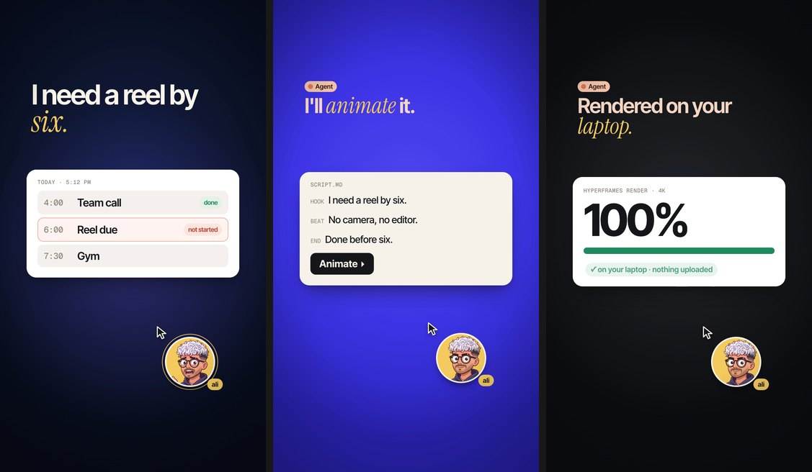 | 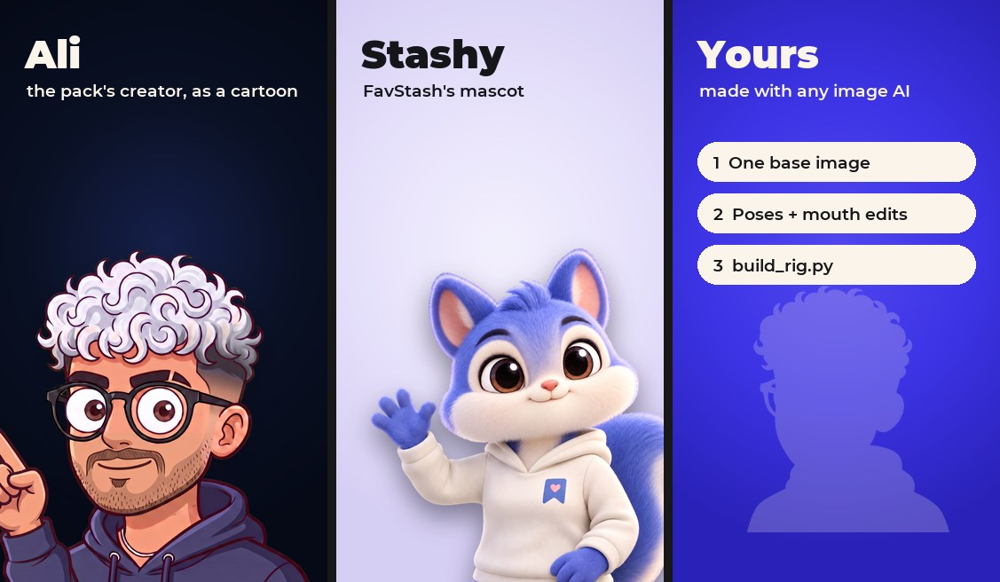 |

[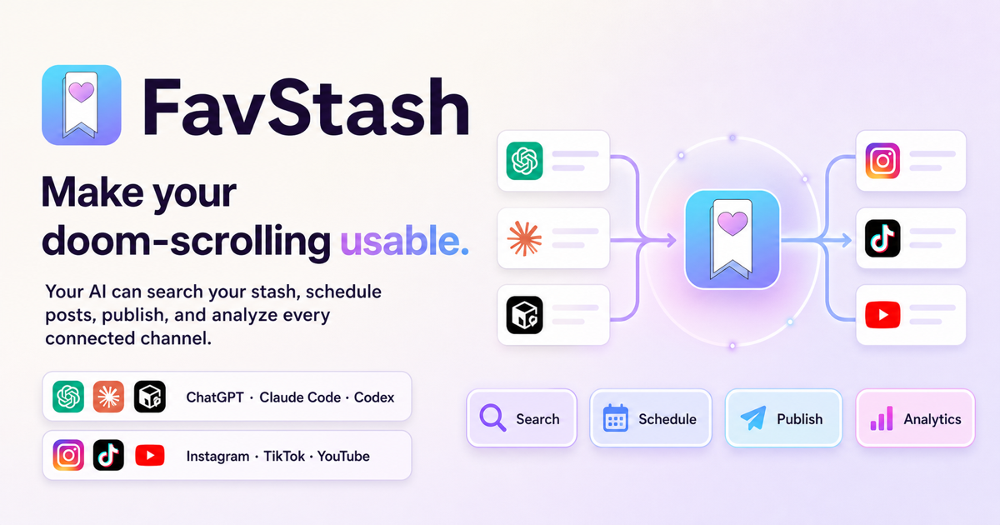](https://www.favstash.app/)

## The creator loop

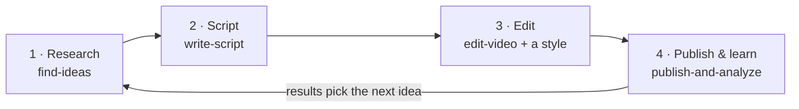

| Stage | Skill | What your agent does |
| --- | --- | --- |
| 1 · Research | [find-ideas](skills/1-research/find-ideas/SKILL.md) | Finds proven reels to adapt (3× their creator's median), reads saved inspiration and suggests what to make next |
| 2 · Script | [write-script](skills/2-scripting/write-script/SKILL.md) | Copies the proven hook, adds as many equally aggressive alternatives as you want to test, writes one shared body in your voice and hands over a filmable brief |
| 3 · Edit | [edit-video](skills/3-editing/edit-video/SKILL.md) | Cuts your takes, removes retakes, adds captions, sound and motion graphics, keeps everything in safe areas and reviews the actual export |
| 4 · Publish & learn | [publish-and-analyze](skills/4-publish-and-learn/publish-and-analyze/SKILL.md) | Exports at full quality, picks a real-frame cover, avoids duplicate holds on hook variants, schedules after your approval and compares results |

Every skill works on its own. [FavStash](https://www.favstash.app/) closes the loop:
your saved reels feed research, approved cuts go to Instagram, TikTok, YouTube or
LinkedIn, and the analytics pick the next test.

## Editing styles

`edit-video` is the base for every edit. Add the style that fits the story; each one
lives on a shelf: [on camera](skills/3-styles-on-camera), [animated](skills/3-styles-animated) or [characters](skills/3-styles-characters).

### No camera needed

#### [animated-explainer](skills/3-styles-animated/animated-explainer/SKILL.md): a fully animated reel, keyed to the voice


Give it a script and it makes the whole reel: one lit colour field and one big hero card per spoken beat, the line lighting up word by word, every click and sound on the frame of its word. Two voices can talk to each other, and a cartoon can drive the UI as a cursor. Rendered on your machine.

#### [3d-character](skills/3-styles-characters/3d-character/SKILL.md): a cute 3D character that talks to camera

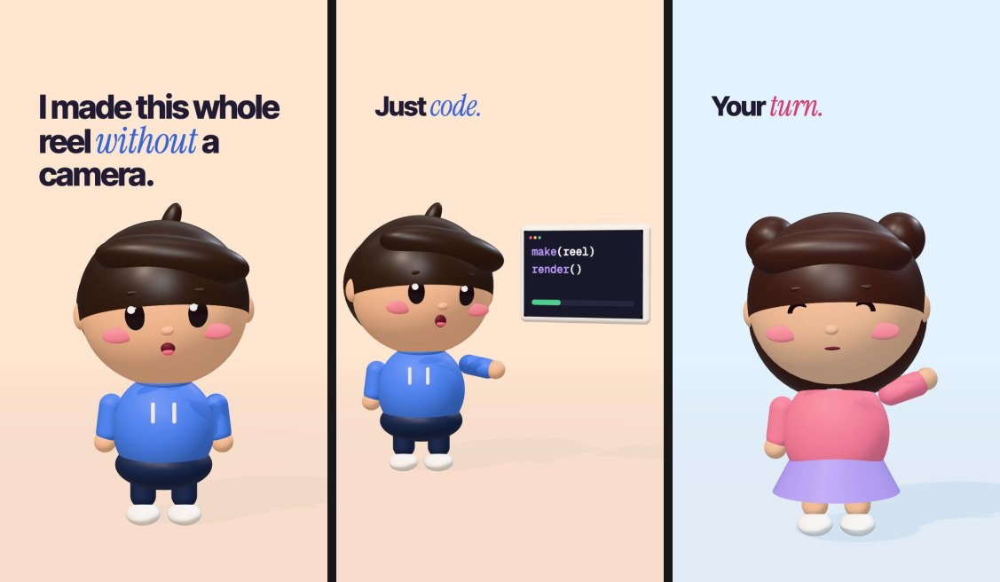

A chibi boy or girl, built in Three.js from simple shapes, talks to camera on a soft pastel stage: lip-synced to the voice, nodding on the words that matter, pointing at a card that types itself, then waving. The camera cuts on the words. No Blender and nothing to install; it renders on your machine like every other style.

#### [cartoon-character](skills/3-styles-characters/cartoon-character/SKILL.md): a lip-synced cartoon of you, or anyone you make


A cut-out cartoon that talks, blinks, frowns, lights up and swaps poses on the beat. Two samples ship (Ali, who made this pack, and Stashy, FavStash's mascot). Make your own from a few photos with any image AI: one base image, a few edits, one command. Use it as the cursor in an animated explainer, a corner presenter on any reel or the star of a cartoon explainer.

#### [product-motion-ads](skills/3-styles-animated/product-motion-ads/SKILL.md): a motion-graphics ad built from your product

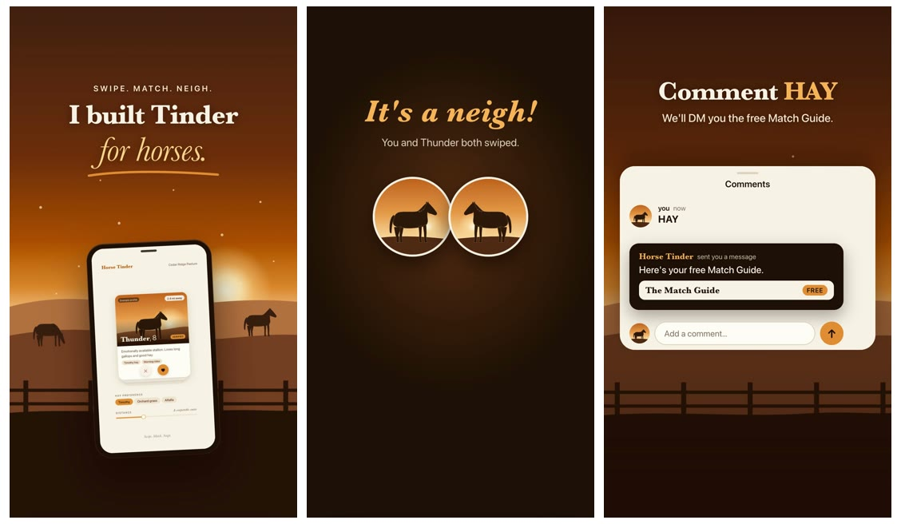

For promoting a product, physical or digital (a gadget, a bottle, an app, a SaaS tool), a free resource or a comment-to-DM giveaway. Your agent plans the story from the product itself (its app, site, photos or packaging), carries one object from scene to scene and locks every sound to its frame. It also makes a 16:9 launch film for YouTube or a landing page.

### With your face or footage

#### [adaptive-glass](skills/3-styles-on-camera/adaptive-glass/SKILL.md): speaker plus moving proof in glass panels

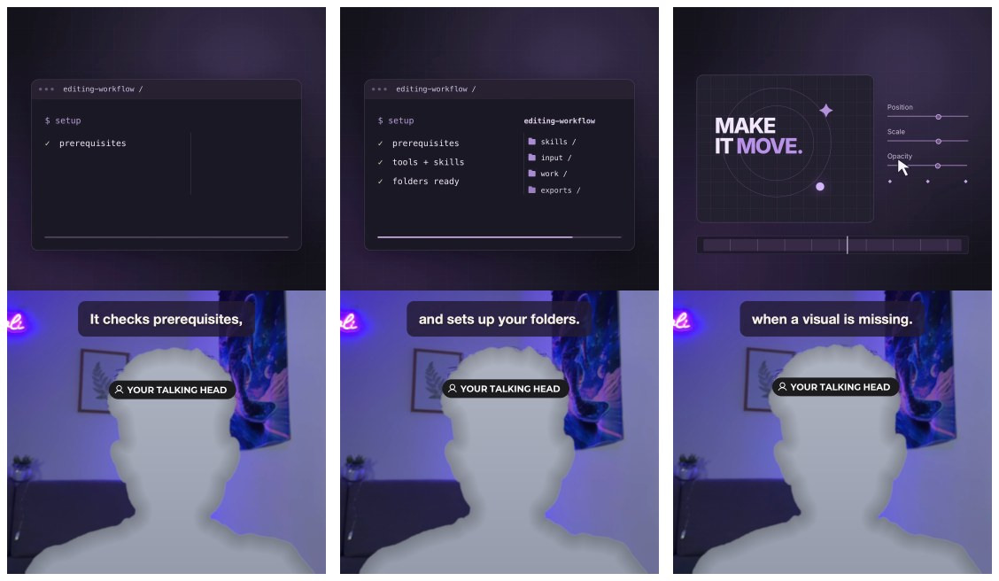

For product, tool and explainer reels with real screen proof. Palettes are matched to your footage.

#### [paper-grid](skills/3-styles-on-camera/paper-grid/SKILL.md): white grid pane, one animated UI artifact per line

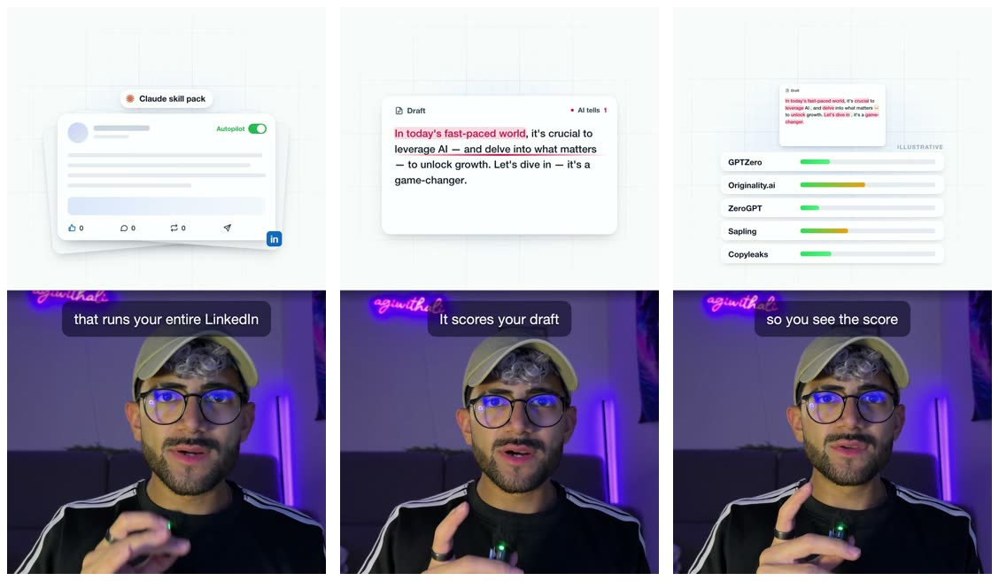

For tool, repo and feature explainers where every sentence names something to show.

#### [breakout-card](skills/3-styles-on-camera/breakout-card/SKILL.md): your head breaks out of a card at the bottom

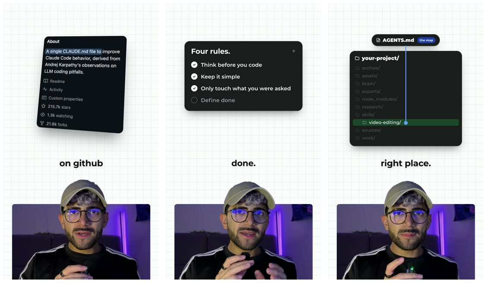

For talking-head explainers that alternate graphics with personal lines. One-to-two-word captions in Montserrat.

#### [motion-effects](skills/3-styles-on-camera/motion-effects/SKILL.md): 33 named effects for any talking-head edit

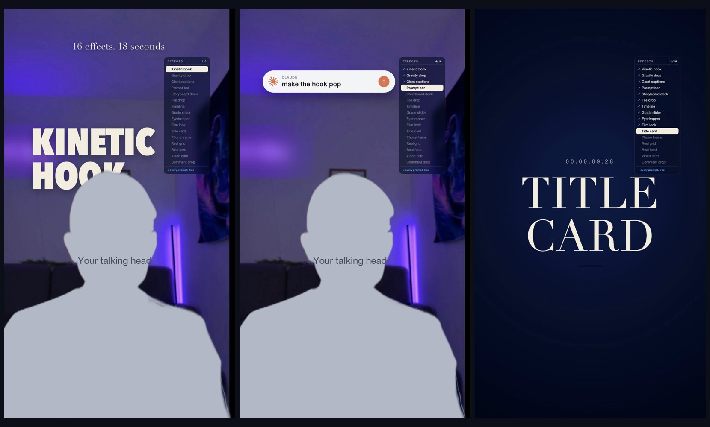

Ask for an effect by name: kinetic hook, gravity drop, giant captions, timeline, grade slider, title card, comment drop, orbit, frame break, vertigo, paper cut, rewind and 21 more. Big words sit behind you, and your own frames, posts and waveform appear inside the UI. Each effect has a copy-paste prompt.

#### [text-over-footage](skills/3-styles-on-camera/text-over-footage/SKILL.md): one readable line over matching B-roll

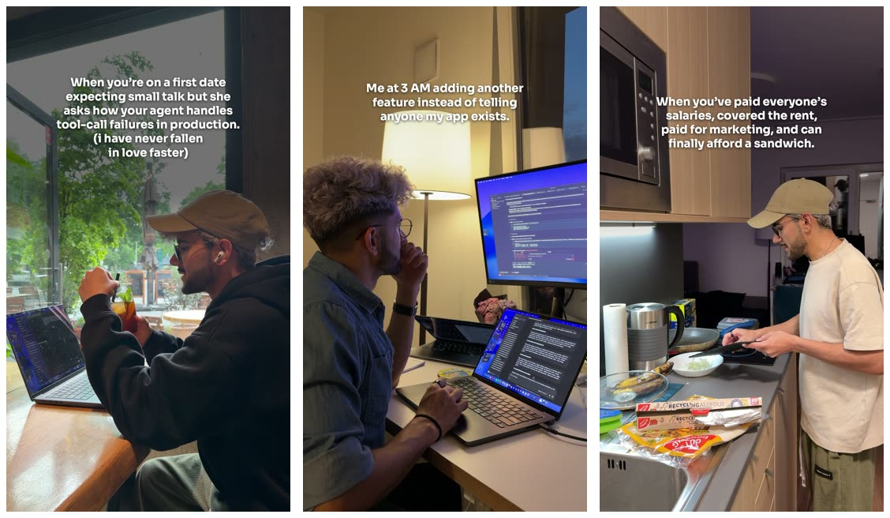

For jokes, observations and setup/payoff reels, with footage matched to the line.

## Voices: yours, free on your laptop, or hosted

Animated reels run on a voice, and every word's timing comes back with it, so each
card, click and sound lands on the word it belongs to.

| Voice | Cost | What you get |
| --- | --- | --- |
| Your own recording | Free | The default: a take per line, in your voice |
| [Chatterbox](https://github.com/resemble-ai/chatterbox) | Free, on your machine | Clones your voice from a ~10 s sample. MIT; Resemble AI stopped updating it in August 2026, but it still runs |
| Kokoro, through `hyperframes tts` | Free, on your machine | Twelve preset voices with nothing extra to sign up for. Apache-2.0 |
| [ElevenLabs](https://elevenlabs.io) | Paid per character | The most natural read, voice clones and exact word timings |

Clone only your own voice, or one you have permission to use. Setup and examples are
in [voice options](skills/3-editing/edit-video/references/voice.md).

## Free to use

The skills are free and open source (Apache-2.0). FavStash's free plan includes
unlimited saved items and stash searches, 100 transcript and AI enrichments, one
connected channel and 10 posts a month. See the [current plans](https://www.favstash.app/#pricing).

## Install

Paste the prompt above into Claude Code, Codex, Cursor or another local coding agent.
It follows [INSTALL_FOR_AGENTS.md](INSTALL_FOR_AGENTS.md) to install the skills,
prepare FFmpeg, HyperFrames and GSAP in your workspace, render a smoke test and
connect FavStash. You only sign in; the agent does the rest.

<details>
<summary>Install the skills yourself</summary>

```bash
npx skills add https://github.com/alisadiq-ai/favstash-ai-video-editing-skills
```

Add `--skill edit-video --skill paper-grid` (for example) to pick skills. The
[agent setup guide](INSTALL_FOR_AGENTS.md) covers media tools and the FavStash connection.

For Claude Code or Codex, the FavStash CLI connects your stash and uploads local files:

```bash
npm install -g @sketric/favstash-mcp@latest
favstash auth login
favstash setup --agent claude-code
favstash doctor
```

Use `--agent codex` for Codex. Other agents connect through FavStash's MCP server
with OAuth ([connection guide](https://www.favstash.app/docs/ai-connect)).

</details>

<details>
<summary>Install as a Claude plugin</summary>

This repository is also a Claude plugin, `favstash-creator-skills`, with all thirteen
skills and the FavStash connector. Load it in Claude Code for one session:

```bash
claude --plugin-dir ./favstash-ai-video-editing-skills
```

Skills are namespaced under the plugin, for example
`/favstash-creator-skills:edit-video`, and Claude also picks them up when your
request fits. Connect FavStash from the plugin's connectors with OAuth. The editing
skills need the local media tools in the [agent setup guide](INSTALL_FOR_AGENTS.md),
so use the plugin in Claude Code or in Cowork on your own computer.

</details>

## Try it

```text
Use $find-ideas to find three proven reels about AI coding tools I could adapt.
```

```text
Use $write-script to adapt this reel into a few hooks to test and one body in my voice.
```

```text
Use $edit-video with $breakout-card to edit these takes into a 40-second reel.
```

```text
Use $edit-video with $product-motion-ads to make a 25-second ad for my app from its code,
ending on "comment TEMPLATE".
```

```text
Use $edit-video with $animated-explainer and $cartoon-character to turn this script into
a 30-second animated reel with my cartoon as the cursor and a free local voice.
```

```text
Use $edit-video with $3d-character to make a 15-second 3D reel where the chibi girl
announces my launch, with camera cuts on the words and a wave at the end.
```

```text
Use $cartoon-character to make a cartoon of me from these three photos with my image
model, then build its rig and show me every pose.
```

```text
Use $edit-video with $motion-effects to add a kinetic hook, a timeline and a comment drop
ending on "comment EDITOR" to my talking-head video.
```

```text
Use $publish-and-analyze to prepare covers and a caption for this cut, then compare
last week's hook test once I approve.
```

## FAQ

**Do I need FavStash?** No. Research, scripting and editing work without it. FavStash
adds your saved inspiration, scheduling and analytics so the loop closes.

**Will my agent post without asking?** No. It delivers a local cut. Posting needs your
approval for the exact file, cover, caption, account and time.

**What runs where?** Editing runs locally with FFmpeg and HyperFrames (Node 22+).
`paper-grid`, `breakout-card`, `animated-explainer`, `3d-character`, `cartoon-character`
and the duplicate check also use Python. The
breakout card's built-in person matte uses Apple Vision on macOS; on other systems,
supply a matte from any segmentation tool.

**What does it send, and where?** The bundled scripts run on your machine and make no
network requests; your footage, renders and preferences stay in your workspace.
Data leaves your machine only through FavStash tools you connect: the remote MCP
server at `https://mcp.favstash.app/mcp` (OAuth) or the FavStash CLI. They search
your stash, read your connected accounts' analytics, and upload and schedule a
post only after you approve the exact file, caption, account and time. See the
[FavStash privacy policy](https://www.favstash.app/privacy).

**Can I use Ali's cartoon or Stashy?** To try and demo the skills, yes. For your own
channel, make your own character; the samples' [terms](skills/3-styles-characters/cartoon-character/characters/README.md)
say what's allowed.

**Can I use a saved reel as a reference?** Yes, for analysis. Adapt its hook,
structure and pacing, and make the video from your own footage. Downloaded footage
and music stay analysis-only unless you have reuse rights.

## Contributing

```bash
npm test
npm run validate
```

See [contributing](CONTRIBUTING.md) and [security](SECURITY.md). Code, instructions
and original SFX use [Apache-2.0](LICENSE); external tools, the bundled fonts and the
sample characters keep their own [licenses](THIRD_PARTY_NOTICES.md). Most style
previews come from the maintainer's own reels, with the speaker replaced by a
placeholder; the animated-explainer preview is a reel the skill built from its own
worked example.
